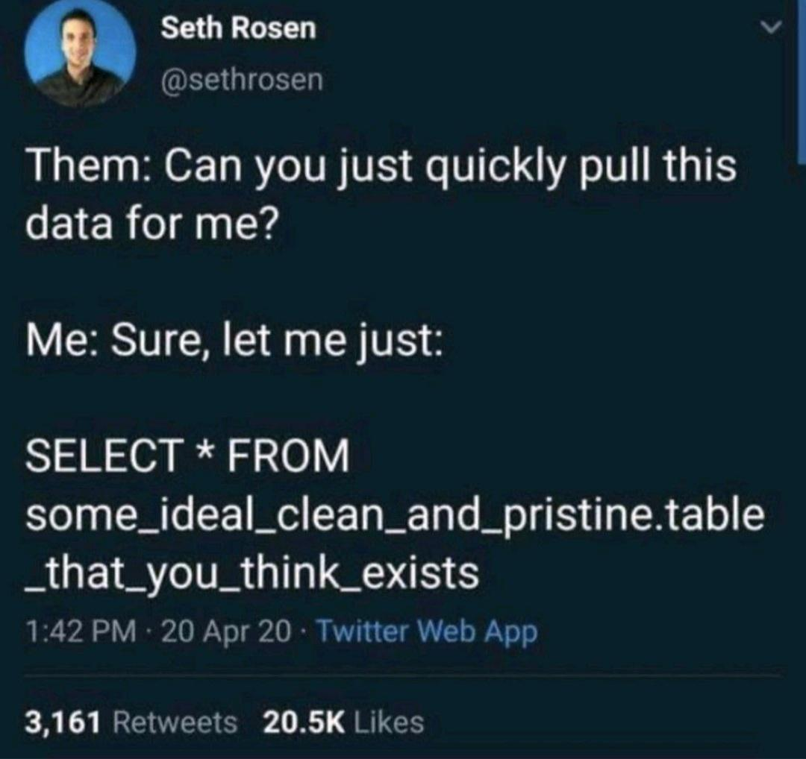
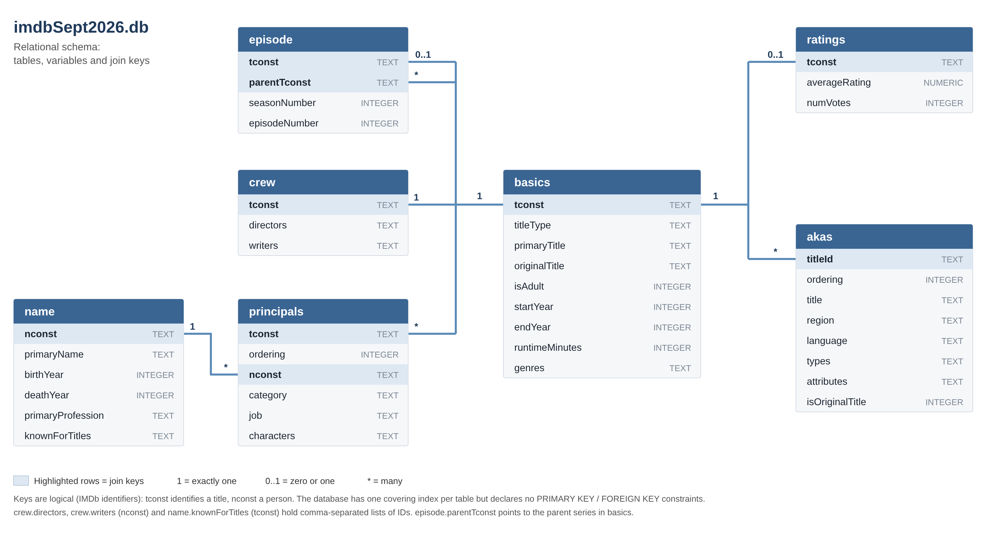
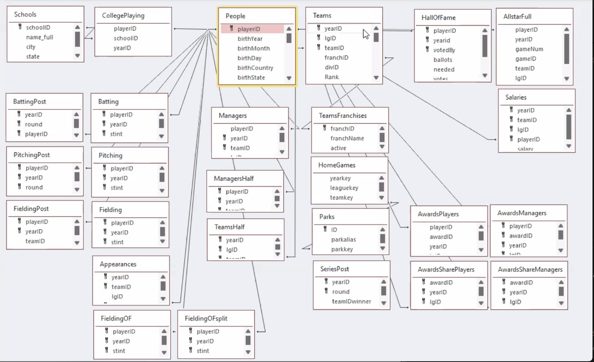

# 0. Kick-off


## Welcome!

Welcome to the half day short course titled *Applied SQL for Data
Analysis: A Practical Introduction to a Key Data Skill*.


## Agenda

Wednesday, October 28, 2026, 8:00 AM to noon

| Time                | Minutes | Topic                             |
|---------------------|---------|-----------------------------------|
| 8:00 - 8:20 AM      | 20      | 0\. Kick off                      |
| 8:20 - 9:00 AM      | 40      | 1\. Basics of Querying            |
| 9:00 - 9:40 AM      | 40      | 2\. Filtering and Sorting         |
| 9:40 - 9:45 AM      | 5       | Break                             |
| 9:45 - 10:25 AM     | 40      | 3\. Aggregation and Grouping      |
| 10:25 - 11:05 AM    | 40      | 4\. Joins: Combining Tables       |
| 11:05 - 11:10 AM    | 5       | Break                             |
| 11:10 - 11:50AM     | 40      | 5\. SQL in R                      |
| 11:50 AM - 12:00 PM | 10      | Wrap up                           |
| On your own         |         | 6\. Real-World Querying Challenge |


## Introductions

- Fulya fgokalp (AT) metu.edu.tr or [LinkedIn](https://www.linkedin.com/in/fulyagokalpyavuz/)

- Maggie betz (AT) purdue.edu or [LinkedIn](https://www.linkedin.com/in/margaretbetz/)


- Participants


## About Structured Query Language (SQL)


Structured Query Language (SQL) is a language used for querying and manipulating data in a database and it provides a relational database management system. SQL allows users to efficiently create, read, update, and delete data in databases. It is widely used across applications, from small projects to large-scale industry systems. For data analysts, data scientists, and software developers, understanding SQL is essential for working effectively with databases.

The language was created by IBM developers Donald Chamberlin and Raymond Boyce in the 1970s and was originally named SEQUEL (**S**tructured **E**nglish **Que**ry **L**anguage). IBM was forced to change the name to SQL (**S**tructured **Q**uery **L**anguage) after a trademark infringement from the UK-based Hawker Siddeley aircraft company.

SQL is officially pronounced as individual letters, "S-Q-L", but the pronunciation "sequel" is  widely used and accepted as well. 

We use [SQLite](https://sqlite.org), which does not require a server to run. The database is built into the application, and the app reads from and writes to the database files directly on disk. SQLite source code is public and free to everyone.



Figure 1. SQL Meme


## Datasets

JupyterLab on [Anvil](https://www.rcac.purdue.edu/compute/anvil), a
supercomputer supported by the National Science Foundation, will be used
for this workshop.


### IMDb

We will use the
[IMDb](https://developer.imdb.com/non-commercial-datasets/) SQLite data
located at: `/anvil/projects/tdm/data/wsds/imdbSept2026.db`\[1\] for
all **demo** content.

The following is an illustration of the database to help you understand
the data.



Figure 2. IMDb database schema diagram. The diagram was generated with Claude (Anthropic) from the schema of `imdbSept2026.db`. Highlighted rows are join keys: `tconst` identifies a title and `nconst` identifies a person. The keys are logical, the database does not declare primary or foreign key constraints.

\[1\] There are 7 data files provided by IMDb:

```
name.basics.tsv.gz
title.akas.tsv.gz
title.basics.tsv.gz
title.crew.tsv.gz
title.episode.tsv.gz
title.principals.tsv.gz
title.ratings.tsv.gz
```

We will use the SQLite database format created from those tsv
(Tab-Separated Values) files.


### Lahman Baseball Database

We will use the [Lahman Baseball Database](http://seanlahman.com/). The
SQLite database on Anvil is located at
`/anvil/projects/tdm/data/lahman/lahman.db`. (For more, you can read the following page of Sean Lahman: <https://seanlahman.com>)

We will use the Lahman data for all **practice on your own** content.

The following is an illustration of the database to help you understand
the data.




Figure 3. Database diagram from
<a href="https://sabr.org/lahman-database/"
class="bare">https://sabr.org/lahman-database/</a>


## Login in to Anvil

Let’s launch a Jupyter session on Anvil by navigating to
<https://notebook.anvilcloud.rcac.purdue.edu> or <https://ondemand.anvil.rcac.purdue.edu>.

Use the ACCESS username that you were assigned (when you setup your
account) and the ACCESS password that you chose. You will need to
authenticate via DUO.

Now launch two notebooks. Since sqlite only references the most recent
database, we recommend having two notebooks open:

1.  Notebook 1 - use for the 'demo' sections which utilize the IMDb
    data. Title this file "demo.ipynb" or "IMDb.ipynb".

2.  Notebook 2 - use for the 'practice on your own' sections which
    utilize the Lahman baseball data. Title this file "practice.ipynb"
    or "baseball.ipynb".

## Jupyter Notebook tips 

1. Each executable command should have it's own cell. 
2. You can create `code` cells or `Markdown` cells but changing the type of each cell at the top menu. To write text in a `code` cell, make sure to start your line with `#`. You do not need to do this for a `Markdown` cell. 
3. To run a cell, you can either select the "play" button in the top menu, or simultaneously hit the following keys: 

        On Mac: cmd + return 
        On Windows: shift + enter

