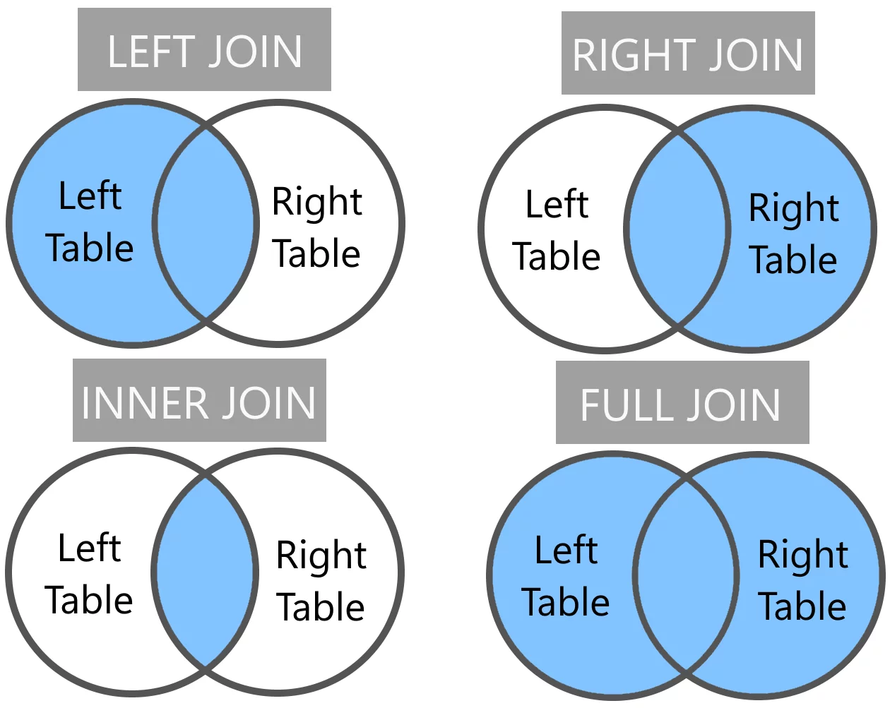

# 4. Joins and other ways to combining or create tables


## Concepts

The `JOIN` command lets us combine data from two or more tables by
matching values in a shared column.

There are 4 primary types of SQL joins: `INNER JOIN`, `LEFT OUTER JOIN`,
`RIGHT OUTER JOIN`, and `FULL OUTER JOIN`.

We will compare `INNER JOIN` and `LEFT JOIN`. In SQL, an `INNER JOIN`
returns only the rows that have matching values in both tables.

A `LEFT JOIN`, on the other hand, returns all the rows from the left
table (the first table in the join) and the matching rows from the right
table (the second table in the join). If there is no match, `NULL`
values are returned for the columns of the right table.



Figure 1. 4 types of SQL `JOINS`


### Additional ways to combine or create tables

| Command | Description | Example | Example Description |
|----|----|----|----|
| `INTO` | A directional command that may be used to create a new table from the results of a query. | `SELECT * INTO new_table FROM table` | Selects all columns from `table` and creates a new table called `new_table` with the results |
| `INSERT` | Used to insert new records into a table. | `INSERT INTO table (column1, column2) VALUES (value1, value2)` | Inserts a new record into the `table` with `column1` set to `value1` and `column2` set to `value2` |
| `UPDATE` | Used to modify existing records in a table. | `UPDATE table SET column = value WHERE condition` | Updates the `column` in the `table` to `value` where the `condition` is met |
| `DELETE` | Used to delete records from a table. | `DELETE FROM table WHERE condition` | Deletes records from the `table` where the `condition` is met |
| `DROP` | Used to delete a table or database. | `DROP TABLE table` | Deletes the `table` from the database |
| `CREATE` | Used to create a new table or database. | `CREATE TABLE table (column1 datatype, column2 datatype)` | Creates a new table called `table` with `column1` and `column2` of specified data types |


### Primary and foreign keys

A primary key is a unique identifier for every record in a table. It
cannot be left `NULL` and every row for this column must be unique.

A foreign key is an identifier used to reference a primary key in a
different (foreign) table. In other words, a foreign key must exist in
another table.


## Demo

Let us simply `INNER JOIN` two tables first:

```sql
%%sql
SELECT * FROM crew AS c INNER JOIN name AS n
ON c.directors = n.nconst LIMIT 5;
```

|  |  |
|----|----|
| Note | This context tells SQL to add all columns from both tables, and then match up the rows based on the common column specified in the `ON` clause. |

We can use the `WHERE` clause and the `IS NULL` operator to list only
crew members who do not have a matching record in the `people` table by using `LEFT JOIN`.

```sql
%%sql
SELECT * FROM crew AS c LEFT JOIN name AS n
ON c.directors = n.nconst
WHERE n.primaryName IS NULL
LIMIT 20;
```

|  |  |
|----|----|
| Note | `RIGHT JOIN` is the opposite of a `LEFT JOIN`, but SQLite does not support it natively. If you need to use a right join, you can typically just use a left join with the order of the tables flipped. Additionally, there is an `OUTER JOIN`, which is a combination of `LEFT JOIN` and `RIGHT JOIN`. It returns all rows from both tables, with NULLs in places where there is no match. However, SQLite does not support FULL OUTER JOIN natively either. By default, `JOIN` returns `INNER JOIN`. |


Let's look at the movies with at least 2,000,000 votes.

```sql
%%sql
SELECT * FROM basics as b JOIN ratings AS r
ON b.tconst = r.tconst WHERE numVotes > 2000000 LIMIT 10;
```
What was the most popular movie (highest rating) in a specific year that had at least 10,000 reviews? 

```sql
%%sql
SELECT * FROM basics as b JOIN ratings AS r ON b.tconst = r.tconst
WHERE (b.startYear = 2020) AND (b.titleType = 'movie') AND (numVotes > 10000) ORDER BY r.averageRating DESC LIMIT 10;
```
You can see that Hamilton is one of the top movies of 2020. 


### Join three tables

Let us see all the movies Christopher Nolan worked on:

```sql
%%sql
SELECT * FROM crew
INNER JOIN name ON crew.directors = name.nconst
INNER JOIN basics ON crew.tconst = basics.tconst
WHERE name.primaryName = 'Christopher Nolan' AND basics.titleType = 'movie';
```

Order them by premiered year:

```sql
%%sql
SELECT * FROM crew
INNER JOIN name ON crew.directors = name.nconst
INNER JOIN basics ON crew.tconst = basics.tconst
WHERE name.primaryName = 'Christopher Nolan' AND basics.titleType = 'movie'
ORDER BY basics.startYear;
```


Now, we want to see what type of productions (movies, video, etc.)
Christopher Nolan is mainly working on (executing this code will take
some time):

```sql
%%sql
SELECT t.type, COUNT(*) AS count
FROM titles AS t
JOIN crew AS c ON t.title_id = c.title_id
JOIN people AS p ON c.person_id = p.person_id
WHERE p.name = 'Christopher Nolan'
GROUP BY t.type
ORDER BY count DESC;
```
He's done 14 movies and 3 shorts. 

We can find what type of movies Christopher Nolan is mainly working on:

```sql
%%sql
SELECT b.genres, COUNT(*) AS count
FROM basics AS b
JOIN crew AS c ON b.tconst = c.tconst
JOIN name AS n ON c.directors = n.nconst
WHERE n.primaryName = 'Christopher Nolan' AND b.titleType = 'movie'
GROUP BY b.genres
ORDER BY count DESC;
```

Let us practice 'GROUP BY' and 'HAVING' with 'JOIN'.

Find the top rated movie names of that premiered in 2000 or after with an average rating of 8 or grater with at least 100,000 votes.

```sql
%%sql
SELECT b.primaryTitle, b.titleType, b.genres, b.startYear, r.averageRating, r.numVotes
FROM ratings AS r
LEFT JOIN basics AS b ON r.tconst = b.tconst
WHERE b.titleType = 'movie'
GROUP BY b.genres, b.startYear
HAVING b.startYear >= 2000 AND r.averageRating > 8 AND r.numVotes > 100000
ORDER BY r.averageRating DESC;
```
The top 3 movies of the 2000's are the 3 Lord of the Rings movies. 

|  |  |
|----|----|
| Note | The `HAVING` clause is very similar to the `WHERE` clause, but the key difference is that it is used to filter results after aggregation, while `WHERE` is used to filter results before aggregation. |


#### WITH

Our queries are becoming longer and more complex with multiple joins.
When we need to run several operations on the same joined data,
repeating those joins can be inefficient and hard to read. To simplify
this, we can use the WITH clause to create a temporary table for the
joined data and run our operations on it. The example below shows how:

```sql
%%sql
WITH joined_table AS (SELECT * FROM ratings AS r LEFT JOIN titles AS t ON r.title_id = t.title_id)

SELECT * FROM joined_table LIMIT 5;
```

|  |  |
|----|----|
| Note | This temporary table joined_data will only exist for the duration of the query (the current code cell in this case). If you want to make it permanent, you can use the `CREATE TABLE` command instead of `WITH`, with the exact same syntax. However, in this case, you will not be able to do this on the IMDb or Lahman dataset as it is stored as a read-only database in Anvil. |


## Practice on your own

Continue using the Lahman Baseball data for the practice questions. 

```sql
%sql sqlite:////anvil/projects/tdm/data/lahman/lahman.db
```
Example 4. Deliverables

4.1. Look at first 5 records in at least 3 tables in the Lahman dataset,
not including the People table.

4.2. Name any columns that appear in multiple tables, or only in a
specific table.

4.3. Describe how the tables might relate to each other.

4.4 Write a SQL query to join the People and Salaries tables using the
playerID column, and limit the results to the first 5 records.

4.5. Write a SQL query to join the People and Salaries tables, and
return the average salary of players grouped by their weight, sorted in
descending order, limiting the results to 10 records.

4.6. Write a JOIN command to combine the `Batting` table with the `People`
table. Answer the next questions with this info.

4.7. Write a SQL query to find how many times Babe Ruth reached the home
plate.

4.8. Write a SQL query to find the average number of points scored by
players born in the 1980s, grouped and ordered by their birth year.

4.9. Query to find the 10 highest scoring players and their names.

4.10. Query to find the 10 highest hitting players and their names.

4.11. Are there any players who appear in both lists? If so, who are
they?


